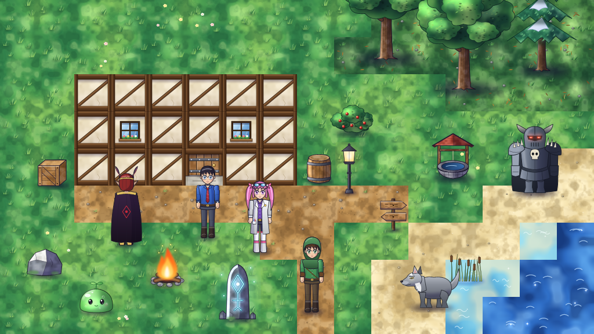

# Stile grafico

Regole per tutta l'arte del gioco (ricette vettoriali in `data/base/art/`, formato in [spec 13](../spec/13-vector-art.md)). Servono a tenere insieme l'aspetto di cose scritte in momenti diversi. Lo stile è quello di un anime: figure con proporzioni credibili, tinte piatte con un'ombra netta, sfondi dipinti. La scelta è spiegata nell'[ADR 0013](../adr/0013-painted-anime-art.md).

## Principi

- **Luce da in alto a sinistra.** Ogni forma ha la sua tinta, un'**ombra netta** sul lato lontano dalla luce e un filo di luce sul lato vicino. L'ombra è un viola freddo **moltiplicato** sui colori (`Recipe.shade()`: strato `blend: multiply`), così ogni tavolozza conserva la sua tinta; la luce è un bianco caldo **aggiunto** dentro la sagoma (`Recipe.lit()`: `blend: add` con `clip`). Niente ombre fatte con nero semitrasparente sopra il colore: ingrigiscono.
- **Linea sottile, nel colore della cosa.** Oggetti, creature e persone hanno un contorno di 0,35-0,5 unità in un colore molto scuro della loro stessa tinta (`#1E1830` per gli oggetti, `outline` della tavolozza per persone e creature). I terreni non hanno contorno.
- **Ombra a terra morbida.** Tutto ciò che sta sul terreno ha ai piedi un'ombra sfumata (`Recipe.shadow()`: due ellissi con `blur`).
- **Materia, non tinta unita.** Legno, pietra, stoffa, fogliame e terreno sono riempiti con un **rumore** (`noise()` di `artkit.py`): nuvole morbide di tre toni vicini. Sopra vanno pochi segni disegnati (venature, crepe, foglie illuminate).
- **Luci che splendono.** Fuochi, lampade, rune e occhi che brillano hanno un alone (`Recipe.glow()`: un'ellisse sfumata con `blend: add`).
- **Colori:** terreni saturi ma non accesi, con chiazze di sole; oggetti e personaggi più saturi; luce calda sui punti importanti. Le creature di una stessa famiglia condividono il corpo e cambiano la tavolozza e il tratto che le distingue.

## Misure

- 32 unità d'arte = 1 tile; il gioco disegna un tile a 64 pixel (scala 2) per la densità dello schermo.
- **Terreni: tasselli grandi.** Un terreno naturale è una ricetta di 128 x 128 unità che copre 4 x 4 tile (spec 13, "Macro tiles"), così il dipinto non si ripete a ogni tile. La base è un rumore che si ripete ogni 128 unità ed è **la stessa per tutte le varianti di un terreno** (da `grass_a` a `grass_f`), così ogni variante si unisce a ogni altra; le cose piccole (ciuffi, fiori, sassi) stanno dentro il proprio tile, lontano dai bordi (`cells()` in `art_tiles.py`). Muri, pavimenti e ponte sono tasselli semplici di 32 x 32.
- **Bordi sfumati.** Nel tileset ogni terreno naturale ha un rango `blend`: il terreno di rango più alto sfuma sul bordo del vicino (l'erba sul sentiero, la sabbia sull'acqua). Lo fanno i client (spec 13, "Ground blending"): nelle ricette non serve nulla.
- **Oggetti:** l'origine è ai piedi (ordine di disegno e collisione). Alberi: 96 x 128, origine (48, 120).
- **Persone:** alte circa 59 unità (1,8 tile) e 4,6 teste. Le parti del rig `humanoid` sono ombra, gambe, braccia, busto, testa e `cape` (mantelli e capelli lunghi dietro il corpo); busto, testa e mantello hanno una seconda ricetta per la **vista di spalle** (`art_back`), usata quando il giocatore cammina verso l'alto.
- **Bestie:** lupi, selvaggina e alfa sono visti di lato e guardano a sinistra (`"faces": "left"`): i client li specchiano perché guardino il giocatore.

## Come si fa

Tutta l'arte è scritta da codice Python e salvata come JSON, che resta il formato che il gioco legge. Si cambia il codice e si rigenera:

| Cosa | Strumento | File |
|---|---|---|
| terreni | `python tools/make_art.py tiles` | `tools/art_tiles.py` |
| oggetti | `python tools/make_art.py props` | `tools/art_props.py` |
| persone, rig e animazioni | `python tools/art_chars.py` | `tools/art_chars.py` (corpo, tavolozze), `tools/art_looks.py` (abiti e acconciature) |
| creature | `python tools/art_creatures.py`, poi `python tools/make_echoes.py` | `tools/art_creatures.py` |

`tools/artkit.py` ha i pezzi comuni: colori, strati con `blur`, `clip` e `blend`, gradienti, rumore, ombre e luci.

Per guardare il risultato senza il gioco: `python tools/art_preview.py <schema>` disegna le ricette in PNG con il rasterizzatore di riferimento (lo stesso algoritmo dei client) e le raccoglie in una pagina e in un'immagine sola; `--figures` disegna ogni persona di fronte, in cammino e di spalle; `--scene` un pezzo di mondo. Nel gioco: `aethermoor --smoke-test --screenshot-dir=...`.

## Persone

- La figura di base è Ren. Ogni protagonista e ogni gente è una **variante**: una tavolozza (`VARIANTS` in `art_chars.py`: pelle, capelli, occhi, abiti) e i suoi strati (`art_looks.py`, con `only`; quelli di Ren con `except`). Un look è una funzione `@look("nome", "parte")` che disegna nelle unità della parte, attorno al suo giunto, e riceve `back` per la vista di spalle; `behind=True` lo mette dietro la parte (una coda, un mantello).
- Gli occhi sono grandi e hanno il colore `eye` della variante: bianco, iride più scura in alto, pupilla, due luci, ciglio superiore spesso.
- Un abito lungo (camice, grembiule, tunica) è un look del busto che scende sopra le gambe: il busto si disegna dopo le gambe.

## Creature

- Ogni creatura tiene la tavolozza del suo file; `art_creatures.py` le dà il corpo della famiglia e il suo tratto: gli slime (`FEATURES`, `ROYAL` con corona e collana, `GIANT`), le bestie (`BEASTS`, `ALPHAS`), i guardiani in armatura (`KNIGHTS`) e le creature disegnate una per una.
- Una creatura nuova: copiare un file della stessa famiglia, cambiarne la tavolozza, aggiungere una riga alla tabella della famiglia con un tratto che la distingua dalle sorelle (non solo un colore), rieseguire lo strumento.
- Gli Echi sono un guardiano ricolorato: li scrive `make_echoes.py`, da rieseguire dopo `art_creatures.py`.

## Luce, vento, aria

Non sono nelle ricette ma nei client, uguali su desktop e Android (spec 08, "The colour of the hour"; spec 13, "Sway"):

- **La luce dell'ora.** Di notte il mondo è moltiplicato per un blu, all'alba e al tramonto per una luce calda; lampioni, falò e Pietre della Soglia **si sommano** a ciò che la notte ha scurito. I colori sono in `grading` di `data/base/lights.json`: si cambiano lì, non nel codice.
- **Il vento.** Una ricetta con `sway` (unità d'arte) si piega con il vento: la base resta ferma, la cima si sposta. Alberi 1-2, cespugli e stendardi meno di 1. `art_props.py` ha la tabella.
- **L'acqua.** Un terreno con `surface: water` si muove: i client ridisegnano lo stesso dipinto spostato di tile interi, con un'opacità che va e viene (spec 13, "Water"). Nella ricetta dell'acqua servono quindi riflessi e chiazze, non onde disegnate in un punto solo.
- **Il colpo.** `humanoid_attack` è l'animazione dell'attacco (in `art_chars.py`, con quelle di attesa e cammino).
- **L'aria.** Pulviscolo nel sole di giorno, lucciole di notte (`motes`), e i bordi dello schermo un po' più scuri (`vignette_pm`).

## Interfaccia

Il testo del desktop è scritto con il font del pack (`data/base/fonts/aether.json`, spec 13 "Font"): ogni lettera è fatta di tratti, disegnati con una penna tonda dal rasterizzatore dell'arte alla misura che serve. Le lettere sono disegnate in `tools/make_font.py` (una riga per lettera: larghezza e tratti, in una cella di 8 x 11 con le maiuscole da 1 a 7 e le minuscole alte 4); `python tools/make_font.py --show prova.png "testo"` mostra una frase. Android usa lo stesso font, cotto una volta in una texture alla misura dello schermo (`PackFont.kt`).

`draw_panel` e `draw_bar` in `desktop/src/app/main.cpp` e `drawPanel` e `drawBar` in `AethermoorGame.kt` disegnano pannelli e barre con lo stesso aspetto; ogni pannello nuovo usa questi.

## Strutture

- Le case degli insediamenti (stamp `hamlet*`, `village*`, `town*`, `outpost*`) sono a graticcio: `wall_timber`, `wall_window` (ogni due tile sul lato alto, e uno sul fianco) e `door` con soglia di pietra. Fortezze, tombe e rovine restano di pietra (`wall_stone`): `make_stamps.py` converte da solo i caratteri `:` `'` `;` in `#` e `_` fuori dagli insediamenti.
- Un edificio nuovo si disegna con `Canvas.house()`: porta e finestre arrivano da sole.

## Costo

Le ricette sono cotte in texture al primo uso. Una ricetta ricca ha qualche centinaio di strati: i rasterizzatori lavorano solo sul riquadro di ogni strato, ma sfumature (`blur`) grandi e rumori a tutta tela costano. Regole pratiche: `blur` sotto le 3 unità salvo gli aloni, al massimo quattro ottave di rumore, niente strati a tutta tela oltre la base.
